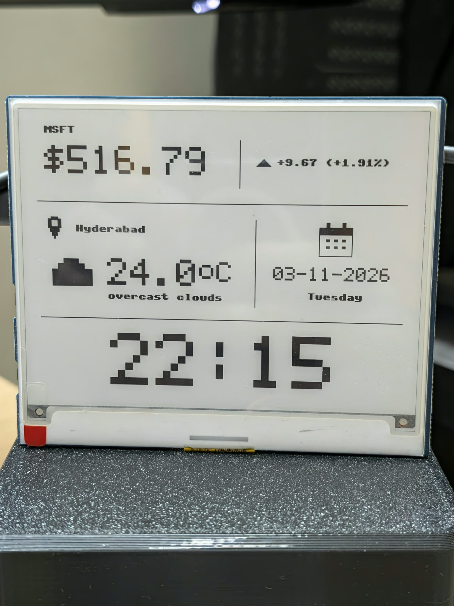
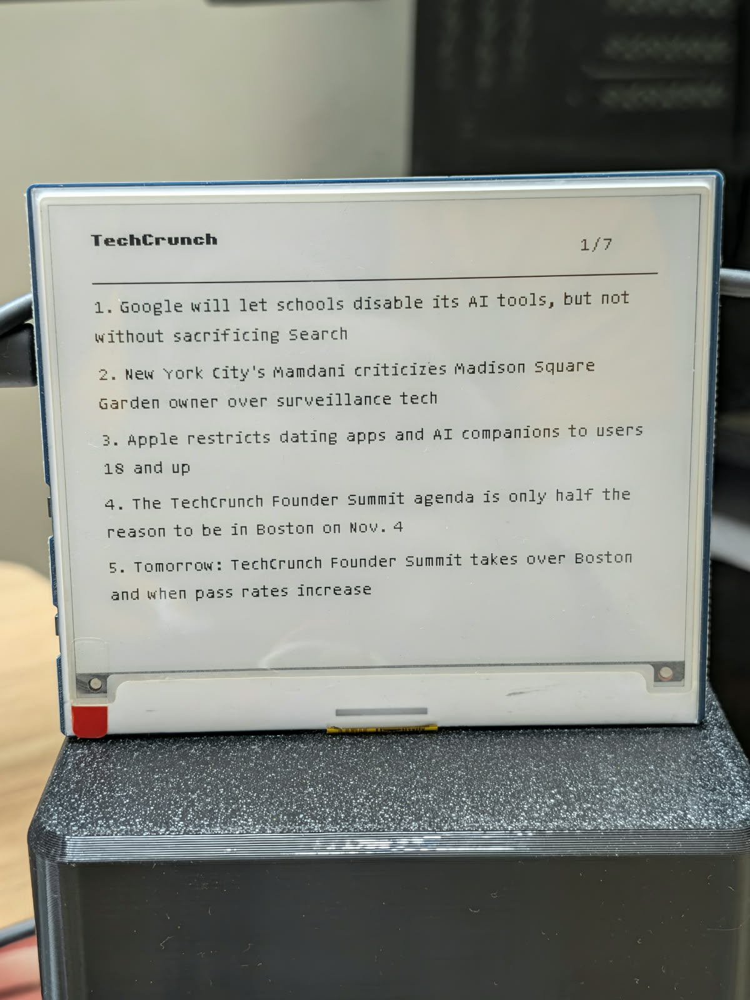

# E-Ink News & Data Dashboard

A real-time market data, weather, date and top news dashboard for a 4.2" e-ink display. All in one glance.

## Features

- **📈 Stock Ticker**: Live stock price and daily change (e.g., MSFT)
- **🌤️ Weather**: Current weather and temperature for your city
- **📅 Date & Day**: Today's date and weekday
- **📰 Top News**: Latest headlines from trusted sources
- **🔄 Auto-Refresh**: Configurable update intervals for all data
- **🛰️ Real-time Clock Sync**: Automatic time synchronization via NTP
- **🎯 Multi-Feed Support**: Browse multiple news sources with button controls
- **🌐 REST API**: Control the display via HTTP API

## Hardware

- **Display**: Waveshare 4.2" E-Ink Display (EPD_4IN2_V2)
- **Microcontroller**: Raspberry Pi Pico (or compatible)
- **Buttons**: 2x Push buttons for navigation
- **WiFi Module**: Required for data fetching

## Screenshots

### Dashboard View
Displays stock price, weather, date and top news headlines.



### News Feed View
Browse individual news sources with navigation controls.



## Setup

### 1. Configure WiFi and API Keys

Create `config.json` from `config.example.json`:

```bash
cp config.example.json config.json
```

Edit `config.json` with your settings:

```json
{
  "wifi_ssid": "your-wifi-name",
  "wifi_password": "your-wifi-password",
  "openweather_api_key": "your-openweather-api-key",
  "stock_symbol": "MSFT",
  "data_update_interval_ms": 900000,
  "time_sync_interval_ms": 21600000,
  "news_update_interval_ms": 900000
}
```

### 2. Required API Keys

- **OpenWeather API**: Get free key at https://openweathermap.org/api
- **Stock Quote API**: Uses CNBC Quote API (no key required)
- **News Feeds**: RSS feeds from TechCrunch, The Verge, Ars Technica, and more

### 3. Upload to Device

Use MicroPython tools to upload files to your Raspberry Pi Pico:

```bash
# Using mpremote (recommended)
mpremote cp config.json :config.json
mpremote cp main.py :main.py
mpremote cp *.py :
mpremote cp -r screens :screens
mpremote cp -r fonts :fonts
```

### 4. Run

```bash
mpremote run main.py
```

## Configuration

### Update Intervals (milliseconds)

```json
{
  "data_update_interval_ms": 900000,      // 15 minutes - stock & weather
  "time_sync_interval_ms": 21600000,      // 6 hours - clock sync
  "news_update_interval_ms": 900000       // 15 minutes - news headlines
}
```

### News Feeds

Add or modify RSS feeds in the `feeds` array:

```json
{
  "feeds": [
    {"name": "TechCrunch", "url": "https://techcrunch.com/feed/"},
    {"name": "The Verge", "url": "https://www.theverge.com/rss/index.xml"},
    {"name": "Ars Technica", "url": "https://feeds.arstechnica.com/arstechnica/index"}
  ]
}
```

### Stock Symbol

Change the stock ticker symbol:

```json
{
  "stock_symbol": "AAPL"  // Apple Inc.
}
```

## Controls

- **Left Button (KEY0)**: Toggle between Dashboard and News Feed views
- **Right Button (KEY1)**: Next news feed (when in feed view)

## REST API

Control the display via HTTP requests:

### Display Dashboard
```bash
curl -X POST http://<device-ip>/render -d '{"type": "dashboard"}'
```

### Display News Feed
```bash
curl -X POST http://<device-ip>/render -d '{"type": "feed", "feed_index": 0}'
```

### Display Custom Data
```bash
curl -X POST http://<device-ip>/render -d '{"type": "custom", "title": "Hello", "content": "World"}'
```

### Update Settings
```bash
curl -X POST http://<device-ip>/render -d '{"type": "settings"}'
```

## Project Structure

```
├── main.py                 # Main application loop
├── config.json            # Configuration file (create from example)
├── config_loader.py       # Configuration management
├── epd4in2_v2.py          # Display driver (Waveshare 4.2")
├── render_api.py          # REST API server
├── xglcd_font.py          # Font rendering
├── bmp_file_reader.py     # Image handling
├── uQR.py                 # QR code generation
├── screens/
│   ├── dashboard.py       # Dashboard view
│   ├── feed.py            # News feed view
│   ├── custom.py          # Custom display view
│   └── common.py          # Common UI utilities
├── fonts/                 # Font files
├── assets/                # Screenshots
└── settings.html          # Web settings interface

```

## Dependencies

- MicroPython standard library: `machine`, `network`, `ntptime`, `time`, `gc`
- Custom libraries: `urequests` or `requests`, display driver

## Troubleshooting

### WiFi Disconnected
When WiFi cannot connect, the display shows a centered, crossed-out WiFi icon
instead of an error message. The device keeps retrying and restores the selected
view after reconnecting. Other errors still display their messages.

### Display Not Updating
1. Check WiFi connection
2. Verify API keys are correct
3. Check update intervals (shouldn't be too frequent)

### Data Fetch Failures
1. Ensure device has internet connection
2. Verify API endpoints are accessible
3. Check request headers in config

### Time Sync Issues
1. Device must have internet connectivity for NTP
2. Verify time sync interval isn't too frequent

## Performance Tips

- **Reduce update intervals** for more frequent refreshes (uses more power)
- **Increase update intervals** to save power (e-ink is low-power by nature)
- **Use partial refresh** when only updating the clock (faster, less power)
- **Full refresh** on every display to maintain image quality

## License

MIT License - Feel free to modify and redistribute.

## Contributing

Contributions welcome! Please submit issues and pull requests.
